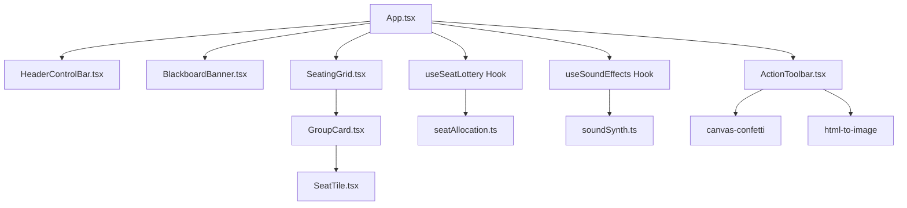

# 우리 반 자리 뽑기 웹앱 (Random Seat Allocation) Implementation Plan

> **For agentic workers:** REQUIRED SUB-SKILL: Use superpowers:subagent-driven-development to implement this plan task-by-task. Steps use checkbox (`- [ ]`) syntax for tracking.

**Goal:** 초·중·고 교실에서 학생 이름 없이 1번부터 N번까지의 번호로 공정하고 흥미진진하게 모둠별 자리를 무작위 추첨하고, 빠른/순차 롤링 애니메이션 및 사운드 효과를 제공하는 웹 애플리케이션 구축.

**Architecture:** React 19와 TypeScript, Vite 기반의 클라이언트 사이드 SPA로 개발하며, Fisher-Yates 무작위 셔플을 통해 공평한 자리 배치를 수행합니다. Web Audio API를 활용한 내장 오디오 합성기와 Canvas-Confetti를 통해 네트워크 단절 환경에서도 생생한 롤링/축하 연출을 지원하고, `@media print` 및 `html-to-image`로 A4 인쇄 및 PNG 저장을 제공합니다.

**Architecture Diagram:**



**Tech Stack:** React 19, TypeScript, Vite, Tailwind CSS, Lucide React, Canvas Confetti, html-to-image, Vitest

**Spec:** [docs/superpowers/specs/2026-10-14-random-seat-allocation-design.md](file:///c:/Antigravity/randumSeat/docs/superpowers/specs/2026-10-14-random-seat-allocation-design.md)

## Global Constraints
- Node.js LTS 환경에서 실행 가능해야 합니다.
- 외부 오디오 파일(MP3 등) 다운로드 없이 브라우저 내장 Web Audio API로 모든 효과음을 합성해야 합니다.
- 학생 이름은 입력/표시하지 않으며 번호(1~N)로만 표시해야 합니다.
- 교실 인쇄 시 불필요한 컨트롤바 및 배경색을 제외하고 깔끔한 A4 표 형태로 출력되어야 합니다.

---

### Task 1: Project Scaffolding & Dependencies Setup

**Files:**
- Create: `package.json`, `vite.config.ts`, `tsconfig.json`, `tsconfig.app.json`, `tsconfig.node.json`, `tailwind.config.js`, `postcss.config.js`, `index.html`, `src/index.css`, `src/main.tsx`

**Interfaces:**
- Consumes: None
- Produces: Vite + React 19 + TypeScript + Tailwind CSS + Vitest 실행 환경

- [ ] **Step 1: package.json 생성 및 의존성 정의**
- [ ] **Step 2: Vite, TypeScript, Tailwind 설정 파일 작성**
- [ ] **Step 3: npm install 실행하여 패키지 설치**
- [ ] **Step 4: Vite 빌드 및 기본 테스트 확인**
- [ ] **Step 5: Git commit**
```bash
git add package.json package-lock.json vite.config.ts tsconfig*.json tailwind.config.js postcss.config.js index.html src/
git commit -m "chore: scaffold vite react project with tailwind and vitest"
```

---

### Task 2: Seat Allocation Logic & Unit Tests

**Files:**
- Create: `src/utils/seatAllocation.ts`
- Test: `src/utils/seatAllocation.test.ts`

**Interfaces:**
- Consumes: `totalStudents: number, totalGroups: number`
- Produces: `allocateSeats(totalStudents: number, totalGroups: number): Group[]`

- [ ] **Step 1: 실패하는 단위 테스트 작성 (`src/utils/seatAllocation.test.ts`)**
- [ ] **Step 2: `npm run test` 실행하여 테스트 실패 확인**
- [ ] **Step 3: Fisher-Yates 셔플 및 균등 분배 알고리즘 구현 (`src/utils/seatAllocation.ts`)**
- [ ] **Step 4: `npm run test` 재실행하여 통과 확인**
- [ ] **Step 5: Git commit**
```bash
git add src/utils/seatAllocation.ts src/utils/seatAllocation.test.ts
git commit -m "feat: implement seat allocation logic with unit tests"
```

---

### Task 3: Sound Synthesizer & Sound Hook

**Files:**
- Create: `src/utils/soundSynth.ts`, `src/hooks/useSoundEffects.ts`
- Test: `src/utils/soundSynth.test.ts`

**Interfaces:**
- Consumes: Web Audio API `AudioContext`
- Produces: `playTick()`, `playChime()`, `playFanfare()` methods from `useSoundEffects(enabled: boolean)`

- [ ] **Step 1: 단위 테스트 작성 (`src/utils/soundSynth.test.ts`)**
- [ ] **Step 2: 오실레이터 합성 유틸 (`src/utils/soundSynth.ts`) 구현**
- [ ] **Step 3: React Hook (`src/hooks/useSoundEffects.ts`) 구현**
- [ ] **Step 4: 테스트 실행 및 통과 확인**
- [ ] **Step 5: Git commit**
```bash
git add src/utils/soundSynth.ts src/utils/soundSynth.test.ts src/hooks/useSoundEffects.ts
git commit -m "feat: implement Web Audio sound synthesizer and hook"
```

---

### Task 4: Seat Lottery State & Animation Hook

**Files:**
- Create: `src/hooks/useSeatLottery.ts`
- Test: `src/hooks/useSeatLottery.test.ts`

**Interfaces:**
- Consumes: `allocateSeats`, `useSoundEffects`
- Produces: `status`, `groups`, `displaySlotValues`, `revealedSeats`, `startLottery()`, `resetLottery()`

- [ ] **Step 1: 실패하는 Hook 테스트 작성 (`src/hooks/useSeatLottery.test.ts`)**
- [ ] **Step 2: 테스트 실패 확인**
- [ ] **Step 3: 롤링 타이머, 순차 공개 및 일괄 공개 로직 구현 (`src/hooks/useSeatLottery.ts`)**
- [ ] **Step 4: 테스트 통과 확인**
- [ ] **Step 5: Git commit**
```bash
git add src/hooks/useSeatLottery.ts src/hooks/useSeatLottery.test.ts
git commit -m "feat: implement seat lottery animation and state hook"
```

---

### Task 5: Blackboard Banner & Header Control Bar Components

**Files:**
- Create: `src/components/BlackboardBanner.tsx`, `src/components/HeaderControlBar.tsx`

**Interfaces:**
- Consumes: 학생 수, 모둠 수, 모드, 사운드 상태 및 설정 핸들러
- Produces: 상단 컨트롤 바 및 칠판/교탁 배너 UI

- [ ] **Step 1: BlackboardBanner 컴포넌트 구현 (초록색 칠판 질감 및 교탁 아이콘)**
- [ ] **Step 2: HeaderControlBar 컴포넌트 구현 (학생수/모둠수 Stepper, 모드 선택, 사운드 토글, 전체화면 버튼)**
- [ ] **Step 3: 유효성 검사 (학생수 < 모둠수 경고) 반영**
- [ ] **Step 4: 컴포넌트 렌더링 확인**
- [ ] **Step 5: Git commit**
```bash
git add src/components/BlackboardBanner.tsx src/components/HeaderControlBar.tsx
git commit -m "feat: add blackboard banner and header control bar components"
```

---

### Task 6: Seat Tiles & Group Grid Components

**Files:**
- Create: `src/components/SeatTile.tsx`, `src/components/GroupCard.tsx`, `src/components/SeatingGrid.tsx`

**Interfaces:**
- Consumes: `Group[]`, `displaySlotValues`, `revealedSeats`, `status`
- Produces: 반응형 모둠 카드 그리드 및 롤링 숫자 좌석 타일 UI

- [ ] **Step 1: SeatTile 컴포넌트 구현 (롤링 애니메이션, 확정 시 펄스/스탬프 효과)**
- [ ] **Step 2: GroupCard 컴포넌트 구현 (모둠 타이틀 배지, 좌석 격자 정렬)**
- [ ] **Step 3: SeatingGrid 반응형 그리드 래퍼 구현**
- [ ] **Step 4: UI 스타일 및 애니메이션 확인**
- [ ] **Step 5: Git commit**
```bash
git add src/components/SeatTile.tsx src/components/GroupCard.tsx src/components/SeatingGrid.tsx
git commit -m "feat: add seat tile, group card, and seating grid components"
```

---

### Task 7: Action Toolbar (Confetti, Print, PNG Download)

**Files:**
- Create: `src/components/ActionToolbar.tsx`, `src/utils/exportUtils.ts`

**Interfaces:**
- Consumes: `onReshuffle: () => void`, `isAnimating: boolean`, `status: LotteryStatus`, `targetRef: RefObject<HTMLElement>`
- Produces: 다시 뽑기 버튼, 인쇄 버튼, PNG 저장 버튼

- [ ] **Step 1: Confetti 발사 유틸리티 구현 (`canvas-confetti`)**
- [ ] **Step 2: html-to-image 기반 PNG 저장 및 브라우저 window.print 연동 (`src/utils/exportUtils.ts`)**
- [ ] **Step 3: ActionToolbar 컴포넌트 구현**
- [ ] **Step 4: 인쇄 시 불필요한 컨트롤 숨김 CSS (`@media print`) 설정**
- [ ] **Step 5: Git commit**
```bash
git add src/components/ActionToolbar.tsx src/utils/exportUtils.ts
git commit -m "feat: add action toolbar with confetti, print and png export"
```

---

### Task 8: App Integration & Full Verification

**Files:**
- Modify: `src/App.tsx`, `src/index.css`

**Interfaces:**
- Consumes: 모든 컴포넌트 및 훅 결합
- Produces: 완전하게 구동되는 자리 뽑기 웹 애플리케이션

- [ ] **Step 1: App.tsx에 전체 상태, 훅, 컴포넌트 연동**
- [ ] **Step 2: Fullscreen API 연동 및 단축키/토글 처리**
- [ ] **Step 3: 전체 테스트 (`npm run test`) 및 프로덕션 빌드 (`npm run build`) 확인**
- [ ] **Step 4: 브라우저 개발 서버 구동 및 실제 뽑기/다시뽑기/사운드/인쇄 종합 검증**
- [ ] **Step 5: Git commit**
```bash
git add src/App.tsx src/index.css
git commit -m "feat: integrate full seat allocation application and verify"
```
